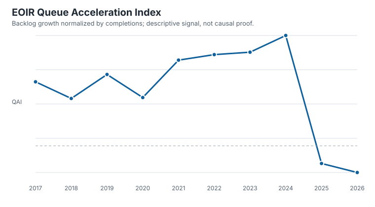

# Open Institutional Capacity Observatory

OICO is a Python package for measuring changes in public-agency backlogs and other records of administrative work. The worked example uses U.S. immigration court data to compare the change in pending cases with the number of cases completed each year.

## Immigration court case study

The preserved U.S. Executive Office for Immigration Review (EOIR) snapshot has 11 annual rows. Study 1 uses fiscal years 2016–2024, which give nine annual observations and eight year-to-year changes. Pending matters rose from 826,488 in 2016 to 3,925,351 in 2024.

The Queue Acceleration Index (QAI) was positive in all eight comparisons. In 2024 it reached 1.580, meaning the backlog grew by 1.580 pending matters for every recorded completion that year. The ratio describes the change in backlog. The data cannot identify its cause or establish staffing failure, legal noncompliance, or institutional intent. EOIR revises its published figures, so the study preserves the input snapshot and [records its provenance](datasets/metadata/eoir_snapshot_provenance.md).



From a clean checkout, run these commands to reproduce the case study.

```bash
python -m pip install -e .
oico reproduce
python -m unittest discover -s tests
```

Run the expanded comparative research layer with `oico reproduce --full`. The Study 1 plan, results, robustness record, and machine-readable outputs are in [`docs/research/`](docs/research/) and [`research/outputs/`](research/outputs/).

The [case study](docs/FLAGSHIP_CASE_STUDY.md) explains how to read the figure and traces it to the source data. `oico reproduce` writes the report to `examples/flagship/outputs/flagship_report.json`.

## What OICO Measures

| Component | Status | Defensible use |
|---|---|---|
| QAI | Stable | Descriptive backlog growth normalized by recorded completions. |
| ASI | Beta | Exploratory coding of accountability specificity in a small document corpus. |
| SEDI | Experimental | Theory-led index of observable degradation signals. |
| Authorization Saturation | Experimental | Illustrative queueing scenarios, not calibrated institutional estimates. |
| Procedural Capacity | Experimental | Transparent risk scenarios for review, contestation, and accountability constraints. |

The status hierarchy is intentional. OICO does not promote a formal model to an empirical measure merely because it is mathematically convenient. See [metric status and boundaries](docs/METRIC_STATUS.md).

The final scientific audit is equally explicit: QAI is a transparent normalized backlog-change signal, not claimed as new mathematics or a direct measure of institutional capacity. The authoritative EOIR interpretation uses FY2016-FY2024; all 11 frozen rows remain in the artifact window, but FY2025 and FY2026 are excluded from the primary inference. See the [EOIR provenance note](datasets/metadata/eoir_snapshot_provenance.md), [claims ledger](CLAIMS_LEDGER.md), [Study 1 results](docs/research/STUDY1_RESULTS.md), and [ultimate final report](docs/research/ULTIMATE_FINAL_REPORT.md). The earlier [research audit](docs/research/FINAL_RESEARCH_AUDIT.md) remains as the historical v1.0.0 audit record.

## Data and Reproducibility

The release uses frozen source snapshots and derived metadata for EOIR, USCIS, CFPB, SEC, and an accountability-document corpus. Each source has a provenance record, checksum, transformation note, and redistribution decision in [the source register](datasets/metadata/source_register.csv) and [the license review](datasets/metadata/license_review.md). The data package does not redistribute linked third-party policy documents.

The reproducibility contract is documented in [REPRODUCIBILITY.md](docs/REPRODUCIBILITY.md). Start with the [three-command reproduction page](https://silvercoin256.github.io/open-institutional-capacity-observatory/reproduce/), then use [REPLICATION.md](REPLICATION.md) and report a result through the [independent reproduction issue form](https://github.com/SilverCoin256/open-institutional-capacity-observatory/issues/new?template=independent-reproduction.yml). Researchers are also invited to [Break OICO](BREAK_OICO.md) with substantive criticism.

## Research Software

```text
oico/                  Python package, CLI, metrics, models, validation
datasets/              Frozen inputs, derived tables, schemas, manifests
examples/flagship/     Canonical EOIR analysis and machine-readable outputs
benchmarks/            Baseline tasks with explicit proxy-label caveats
figures/               Deterministic SVG figures and manifest
docs/                  Methods, audits, tutorials, adoption, and release notes
notebooks/             Executable walkthroughs
website/               Static research site
tests/                 Unit, data, integration, and reproduction tests
community/             Contribution, governance, and researcher onboarding
```

## Install and Extend

OICO requires Python 3.10 or newer and has no runtime dependencies. The public API currently exposes `oico.queue_acceleration_index`; the CLI provides data building, validation, figures, benchmarks, the flagship case, reproduction, and release auditing. Contributions should add provenance, tests, assumptions, limitations, and a clear expected misuse statement.

## Scientific Boundaries

OICO is descriptive and diagnostic unless a future study supplies stronger identification. Public traces are incomplete observations of institutional processes. QAI is close to normalized backlog change; ASI measures document language rather than operational accountability; SEDI and the two formal models remain experimental until externally calibrated. No module alone measures institutional quality, human effort, intent, legal compliance, or causal AI impact.

## Citation and License

Cite the release using [CITATION.cff](CITATION.cff). No DOI is claimed until a real archival record is published. Code is MIT-licensed. Dataset metadata and derived documentation are CC BY 4.0 where stated; underlying sources retain their original terms. See [AI usage disclosure](AI_USAGE.md), [design decisions](docs/DESIGN_DECISIONS.md), [external-validation status](docs/EXTERNAL_VALIDATION.md), and the [Zenodo deposit metadata](.zenodo.json).

Project site: <https://silvercoin256.github.io/open-institutional-capacity-observatory/>

Repository: <https://github.com/SilverCoin256/open-institutional-capacity-observatory>
